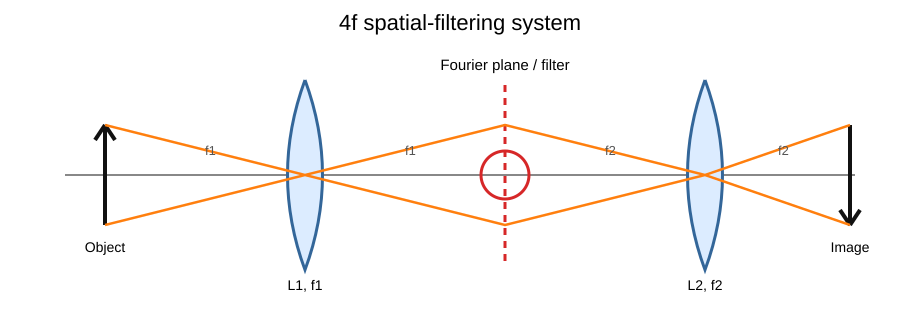
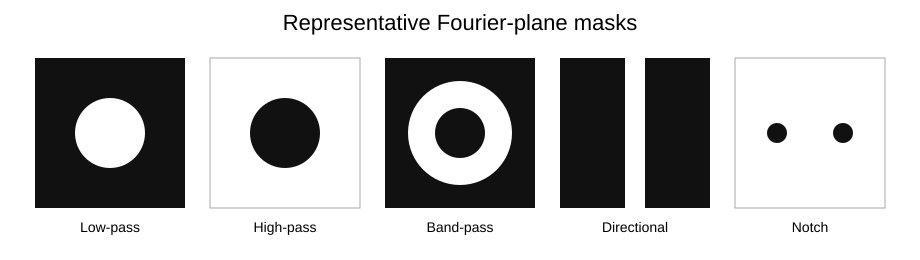
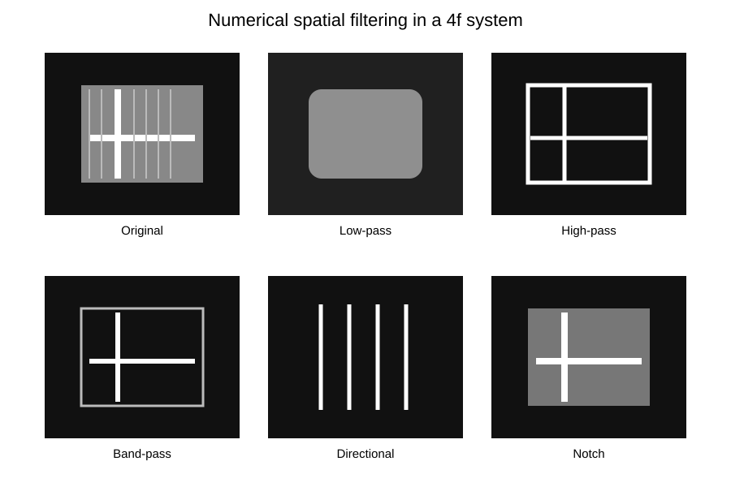

# Fourier Optics — 4f Spatial Filtering

Experimental design and computational companion for a coherent **4f optical system**, connecting Fourier transforms, diffraction, image formation and spatial-frequency filtering.

## Core model

For an object placed one focal length before the first lens, the common focal plane acts as the Fourier plane. A two-lens 4f system reconstructs the object with transverse magnification

`M = -f2/f1`.

For a periodic object, diffraction-order positions in the Fourier plane encode spatial frequency. A circular low-pass aperture of radius `R` has an approximate cutoff

`νc = R/(λ f1)`.

## Spatial filters explored

- **low-pass** — suppresses fine spatial detail and smooths the reconstructed image
- **high-pass** — suppresses slowly varying components and emphasizes edges
- **band-pass** — selects an intermediate range of spatial scales
- **directional** — transmits selected Fourier-space orientations
- **notch** — removes localized spectral components associated with a periodic disturbance
- **progressive harmonic reconstruction** — illustrates how a rectangular grating is rebuilt as additional Fourier orders are transmitted

## Computational companion

The repository includes a numerical Fourier-filtering demo that mirrors the physical intuition of the proposed experiment without presenting simulated output as experimental measurement.

- [`python/fourier_filter_demo.py`](python/fourier_filter_demo.py)
- [`python/fourier_filter_demo.ipynb`](python/fourier_filter_demo.ipynb)

## Experimental design

[`report/README.md`](report/README.md) summarises the complete design proposal: alignment, localisation of the Fourier plane, quantitative magnification checks, diffraction-order measurements, low-pass cutoff analysis and qualitative filter studies. A privacy-cleaned PDF edition is included in the downloadable portfolio bundle.

The document is an **experimental design**, not a claim that all proposed measurements were physically performed.

## Author

**Adrià Saz Guerra** — Optics Laboratory, Universitat Autònoma de Barcelona

## Tools and concepts

Fourier optics, Fraunhofer diffraction, coherent imaging, spatial-frequency filtering, Python, NumPy and Matplotlib
